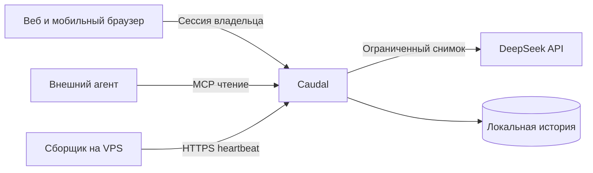

# Caudal. Продукт и архитектура

Исследование от 27 ноября 2026 года. Первый пользователь управляет несколькими личными VPS, иногда из сети, откуда отдельные маршруты недоступны. Ему нужно понимать состояние инфраструктуры, безопасно повторять удачные операции и получать результат там, где запрос был начат. Например, попросить в ChatGPT конфиг для Пети, подтвердить выпуск с телефона и отправить файл через системное меню.

## Где появляется преимущество

Через SSH агент получает доступ к одному хосту и заново выясняет его роль, состояние и допустимые действия. Caudal хранит актуальную картину всего парка, реестр доступных операций и результат каждого запуска. Следующий клиент сможет продолжить тот же `run_id`, даже если пользователь начал работу в Claude CLI и вернулся с телефона. Модель предлагает действие, а ограничения, подтверждение и сохранение результата выполняет сервис. Один доменный метод обслуживает веб, MCP и внутреннего помощника.

| Существующий инструмент | Сильная сторона | Как использовать в Caudal |
| --- | --- | --- |
| Tailscale | Прямое соединение, ретрансляция, сведения о типе соединения. [Документация](https://tailscale.com/docs/reference/connection-types) | Подключать как транспорт авторизованного маршрута и показывать, каким путём пришло наблюдение. |
| Teleport | Доступ на основе ролей, короткоживущие удостоверения, прокси и обратные туннели. [Архитектура](https://goteleport.com/docs/reference/architecture/agents/) | Наследовать политику Teleport и брать роль автоматизации через Machine & Workload Identity, когда админ кластера её выдаст. |
| Ansible AWX | Версионируемые шаблоны и запуск workflow с подтверждением. [Документация](https://docs.ansible.com/projects/awx/en/24.6.1/userguide/workflow_templates.html) | Вызывать согласованный шаблон как один типизированный шаг и прикладывать его результат к запуску. |
| Prometheus, Netdata, OpenTelemetry | Экспорт хостовых метрик, репликация от дочернего агента, сбор метрик, логов и трейсов. [Node Exporter](https://prometheus.io/docs/guides/node-exporter/), [Netdata Parent](https://learn.netdata.cloud/docs/netdata-parents/parent-child-configuration-reference), [OTel Collector](https://opentelemetry.io/docs/collector/deploy/agent/) | Ссылаться на существующие данные и выбирать ограниченные сигналы по задаче и бюджету VPS. |
| Codex и Claude Code | Продолжение сессии, которая исполняется на подключённой машине. [Codex](https://learn.chatgpt.com/docs/remote-connections), [Claude Code](https://code.claude.com/docs/en/remote-control) | Связать сессию с хостом, запуском, артефактами и разрешениями Caudal. |

Первая проверка ценности — показать один запрос о состоянии нескольких хостов в браузере и внешнем клиенте, включая воспроизводимую ссылку на измерение. Следующая — выполнить один повторяемый сценарий с одинаковым результатом из веба и CLI. Замеры времени, числа ручных шагов, стоимости модели и ошибок сравниваются с привычным сценарием владельца. Оценка рынка и пользовательские интервью пока открыты.

## Границы первого релиза

Первый срез `v0` рассчитан на одного владельца. Веб-сессия открывает регистрацию ноды и историю измерений. Непривилегированный Linux-сборщик сам отправляет heartbeat по HTTPS. Отдельный токен разрешает публикацию только для своей ноды. Control plane хранит ограниченную историю, до 120 измерений на ноду. При интервале 30 секунд это около часа. После 90 секунд без heartbeat запись устаревает. До первого пакета она ожидает подключения. Причины потери связи требуют отдельных измерений.

Control plane на Go использует стандартную библиотеку и официальный MCP SDK. Сборщик использует стандартную библиотеку и выпускается для Linux amd64 и arm64. Такой стек даёт один бинарник на процесс, простое развёртывание и готовую реализацию MCP. Rust с Tokio остаётся кандидатом для части, где профиль нагрузки покажет пользу от смены рантайма. Для текущего объёма важнее измерить цену TLS, частоту сбора и запись истории. [Go MCP SDK v1.8.0](https://github.com/modelcontextprotocol/go-sdk/releases/tag/v1.8.0)

Веб на React применяет паттерны Aspect UI. DeepSeek получает запрос и ограниченный снимок доступных измерений. Сервер привязывает ответ к фактам, которые передал модели. Снимок фиксирует, какие данные были доступны при генерации. Свободный текст пользователя тоже попадает в запрос к провайдеру, поэтому интерфейс должен отличать диагностику с внешней моделью от локального просмотра. [DeepSeek API](https://api-docs.deepseek.com/)

Читающий MCP Streamable HTTP защищается независимым bearer. Целевые версии протокола для проверок — `2025-11-25` и `2026-07-28`. Клиент, который умеет настраивать Bearer-заголовок, может обращаться к одному каталогу нод и их измерениям. Каждый новый вид клиента проходит проверку discovery, авторизации, корректного ответа и отказа с неверным токеном. [Транспорт MCP 2025-11-25](https://modelcontextprotocol.io/specification/2025-11-25/basic/transports), [спецификация MCP 2026-07-28](https://modelcontextprotocol.io/specification/2026-07-28), [Claude Code MCP](https://code.claude.com/docs/en/mcp)

Релиз с одним владельцем подходит для телеметрии. Мультиаккаунт, выдача конфигов, выполнение заданий, подключение к кластерам по выданным ролям и посредник для агентной сессии запланированы на следующие этапы.

## Доступность как история наблюдений

Хост, выход в сеть, доступность сервиса и права конкретного пользователя — разные наблюдения. Базовая запись включает `subject_ref`, `vantage_ref`, `route_ref`, `check_kind`, `observed_at`, `received_at`, `expires_at`, `outcome` и категорию сбоя. Для HTTP допустимы этапы `dns`, `tcp`, `tls`, `http`, `application`. Для входа в кластер добавляется `auth`. Для локальной службы существует наблюдение `service`. Метка `stale` описывает срок годности данных. Исчезновение всех свидетельств переводит доступность в `unknown`.

Пример диалога на телефоне. Владелец спрашивает, почему панель сервиса не открывается из текущей сети. Caudal показывает heartbeat 12 секунд назад, успешный внешний HTTPS с контрольного узла и таймаут TLS в пользовательской сети. Статус авторизации пока неизвестен. Можно открыть время, точку измерения и техническую категорию ошибки. Вывод «проблема зависит от точки проверки» опирается на эти записи. Для проверки гипотезы о DNS, фильтрации или неисправном прокси нужны дополнительные наблюдения.

Маршруты описываются отдельно от нод, с типом `direct`, `ssh_jump`, `teleport_proxy` или `outbound_agent` и разрешёнными средствами проверки. Проверки запускаются только для конкретных зарегистрированных целей с правами владельца, лимитами и повторной валидацией на исполняющем узле. `ProxyJump` можно использовать на доверенном клиенте с отдельной проверкой ключей промежуточного и конечного хоста. В ленте нужно различать данные локального агента, результаты конкретного контрольного узла и неподтверждённые ручные наблюдения. [OpenSSH](https://man.openbsd.org/ssh_config)

Для Teleport начать с имени веб-прокси и точной ошибки Chrome. Проверить системное время, DNS, достижимость, публичную TLS-цепочку и совпадение имени с сертификатом. После успешного TLS проверить редирект к IdP, MFA и правила устройства. `tsh status` показывает профиль и срок действия SSH-сертификата. `tsh login` выдаёт короткоживущий сертификат для клиента, а веб-вход обычно создаёт сессию на прокси. Если виден запрос клиентского TLS-сертификата или корпоративного корневого CA, точные требования сообщает администратор кластера. Для регулярной автоматизации нужна отдельно выданная роль и удостоверение `tbot`. [Клиенты Teleport](https://goteleport.com/docs/connect-your-client/teleport-clients/), [tsh](https://goteleport.com/docs/connect-your-client/teleport-clients/tsh/), [Machine & Workload Identity](https://goteleport.com/docs/machine-workload-identity/machine-id/access-guides/applications/)

## Навыки, запуски и артефакты

В реестре **операция** является типизированным действием, **навык** хранит версию графа операций, **запуск** фиксирует состояние выполнения, а **артефакт** описывает файл или другой результат. **Подключение** привязывает ноду или внешний API к конкретной политике доступа. **Представление** описывает разрешённый компонент для выбранных полей результата. Эта схема подходит для установки модели на GPU, чтения логов, сети из нескольких хостов и выдачи одного файла.

| Контракт | Ключевые поля и правила |
| --- | --- |
| `OperationSpec` | `id`, `version`, `input_schema`, `output_schema`, `required_capabilities`, класс эффекта, таймаут, правила повтора, набор подтверждений. Вход и выход валидируются независимо от модели. |
| `SkillRevision` | `skill_id`, `revision`, `digest`, `authored_by`, целевые ресурсы, закреплённые версии операций, предусловия и постусловия, лимиты, тесты на фикстурах. Редактирование создаёт новую ревизию. |
| `Plan` и `Approval` | План связывает субъекта, целевой ресурс, параметры, версию навыка и наблюдения. Подтверждение привязано к хешу плана, диапазону целей и TTL. Изменился хост, версия или эффект — нужен новый план. |
| `Run` | `run_id`, `idempotency_key`, `state`, `attempt`, `step`, ссылка на план и курсор событий. Переходы `queued → running → succeeded/failed`, `waiting_approval`, `canceled` и `needs_reconcile`. |
| `ArtifactRef` | `artifact_id`, MIME-тип, размер, срок жизни, SHA-256 там, где допустимо, уровень чувствительности и политика выдачи. Ключевые материалы передаются по отдельному утверждённому каналу. |
| `RunReceipt` | Выполненные этапы, фактический эффект, использованные наблюдения, результаты проверок, артефакты и следующий доступный шаг. |

Агент может превратить успешный запуск в черновик навыка. Черновик проходит проверку схемы, запуск на тестовых данных и, при необходимости, пробный запуск на разрешённом узле. Публикацию утверждает владелец. Перед каждым реальным повтором система проверяет предусловия, свежесть фактов и доступ. При расхождении версий она сообщает, какая проверка разошлась, и предлагает обновлённый черновик. Поиск подходящей операции начинается с каталога разрешённых навыков для выбранного ресурса. Сжатый контекст включает последние факты, ссылки на историю и релевантные версии. Память о предпочтениях и прошлых действиях имеет видимые источники, срок хранения и возможность удаления в настройках.

Для создания эффектов нужен ключ идемпотентности на намерение в рамках владельца и операции. Повтор того же намерения возвращает тот же запуск. При потере связи после записи runner сначала сверяет состояние по идентификатору операции. При неизвестном эффекте задача переходит в `needs_reconcile`. Долгая задача получает lease и номер поколения выполнения. Исполнитель с просроченным lease не подтверждает завершение. Удаление узла или отзыв права отменяет выдачу следующих lease. Отмена активного шага сохраняет уже выполненные эффекты и указывает возможное компенсирующее действие.

Для обмена навыками можно поддержать экспорт документации в формат `SKILL.md` и MCP Prompts как подсказки пользователю. Происхождение файла, его текст и экспериментальное `allowed-tools` не выдаются за полномочия. В Caudal полномочия остаются в проверяемом контракте операции и политике владельца. [Agent Skills](https://agentskills.io/specification), [MCP](https://modelcontextprotocol.io/specification/2026-07-28)

## Протоколы вокруг домена

| Протокол | Что даст | Первый полезный сценарий |
| --- | --- | --- |
| MCP Streamable HTTP | Портативный каталог JSON Schema-инструментов. Resources подходят для доступных по ссылке снимков, Prompts для стартовых инструкций. `structuredContent` даёт клиенту данные, текстовая часть сохраняет читаемость. [MCP](https://modelcontextprotocol.io/specification/2026-07-28) | Список нод, текущее состояние и история. Позже `operations_plan`, `operations_submit`, `runs_get`, `runs_cancel`. Для долгих работ базовый `run_id` и опрос работают даже в клиентах без расширения задач. |
| OAuth для MCP | Авторизация конкретного пользователя и клиента с `resource`, scopes и коротким TTL. [MCP Authorization](https://modelcontextprotocol.io/specification/2026-07-28/basic/authorization), [ChatGPT Plugins Auth](https://developers.openai.com/plugins/build/auth) | Дать ChatGPT читать отдельный workspace. На пути к пользовательскому MCP endpoint потребуются Protected Resource Metadata, 401 challenge, metadata сервера авторизации, authorization code + PKCE S256, согласование регистрации клиента и проверки issuer, audience, срока и scopes. Проверить требования целевого workspace и каждый write tool отдельно. |
| MCP Apps и OpenAI Apps SDK | MCP Apps связывает инструмент с UI-ресурсом `ui://` и предоставляет sandboxed iframe и мост `ui/*`. ChatGPT использует открытый мост и предлагает дополнительные возможности через `window.openai`. [MCP Apps](https://github.com/modelcontextprotocol/ext-apps/blob/main/docs/overview.md), [OpenAI UI](https://developers.openai.com/plugins/build/chatgpt-ui) | Карточка состояния парка или сравнение маршрутов прямо в ChatGPT. Данные возвращаются текстом и отдельно структурированно. Подтверждения и выдача файлов проверяются доменом даже при вызове из iframe. |
| A2UI | Декларативное описание поверхностей и событий, рендер из каталога доверенных React-компонентов. Текущие документы сайта ориентированы на v1.0. [A2UI](https://a2ui.org/), [сообщения](https://a2ui.org/reference/messages/) | Компоненты Aspect для графика, истории операции и формы подтверждения. Валидатор принимает разрешённые компоненты, действия и размеры, а HTML и код от модели остаются текстом. |
| A2A | Агент с опубликованными возможностями, `Task`, `Message` и `Artifact`. Основная стабильная ветка спецификации — 1.0. [A2A](https://a2a-protocol.org/latest/specification/) | Делегировать STT исполнителю, принадлежащему другому сервису. Результат и отмена маппятся на `run_id`, передаются только утверждённые файлы и права на конкретную задачу. |
| AG-UI | События жизненного цикла, текста, вызовов инструментов и пользовательского состояния. [AG-UI](https://github.com/ag-ui-protocol/ag-ui/blob/main/docs/concepts/architecture.mdx) | Синхронизировать с телефоном статус долгой задачи, подтверждение и результат. Начать с журнала событий и курсора. Добавить адаптер, когда потребуется внешний совместимый frontend. |
| WebMCP | Браузер регистрирует функции текущей страницы как инструменты для браузерного агента. Эксперимент Chromium. [Chrome Early Preview](https://developer.chrome.com/docs/modern-web-guidance/guides/webmcp/webmcp) | Включаемый эксперимент «открой карточку хоста» или «подготовь план», использующий сессию веба и обычные проверки действий. |
| ACP | Интерфейс между редактором и coding agent, включая работу с сессией, запросы разрешений, события инструментов и терминала. [Agent Client Protocol](https://agentclientprotocol.com/protocol/v1/overview) | Рассмотреть единый адаптер сессий, если Caudal станет управлять несколькими coding agent с телефона или из IDE. |

Для взаимозаменяемости клиентов первыми контрактами служат HTTP/OpenAPI, JSON Schema операций и журнал событий с устойчивыми ID. CloudEvents полезен при вынесении событий наружу. OTLP подходит для диагностики работы самого Caudal и подключения внешней наблюдаемости. Операции, навыки, события и артефакты остаются доступными через переносимые структуры независимо от конкретного UI-протокола. [CloudEvents](https://cloudevents.io/), [OTLP](https://opentelemetry.io/docs/specs/otlp/)

У DeepSeek Harness есть собственный клиент `@deepseek-ai/dsh-mcp-client`. Его Streamable HTTP поддерживает настраиваемые заголовки и ссылки на секреты. Узкий тест для Caudal — подключить каталог в разрешённой области, вызвать одну операцию чтения и проверить текстовый результат. Для STT тот же клиент получит `run_id` и ссылку на артефакт. Документация отмечает отсутствие поддержки MCP prompt templates, поэтому пользовательский маршрут должен работать через инструмент и текстовый ответ. [DeepSeek Harness MCP](https://github.com/deepseek-ai/deepseek-harness/blob/master/packages/mcp/mcp-client/README.md)

## Секреты и границы доверия

- Учётные данные сервера остаются на доверенном устройстве или в инфраструктуре владельца. Для машинного доступа исполнитель получает ограниченный сертификат или право на один типизированный вызов. Сервер Caudal видит ID секрета и результат, а владелец может отозвать выдачу.
- Если пользовательский BYOK вызов выполняет централизованный сервис, сервису нужен доступ к ключу в момент запроса. Vault и шифрование с отдельными ключами защищают данные при утечке базы. Чтобы защитить ключ от оператора самого control plane, вызов должен делать процесс под контролем владельца. Если тот же оператор отдаёт веб-страницу, которая расшифровывает секрет, ему технически доступна подмена этой страницы. Поэтому доверенный исполнитель принадлежит владельцу, сам проверяет подписанное подтверждение и принимает обновления из согласованного источника.
- Для разных владельцев у каждой строки инвентаря, запуска и артефакта есть tenant, полученный из удостоверения. Операции проверяют доступ на чтение, планирование, запуск, отзыв и получение артефакта отдельно. Токен агента, веб-сессия и OAuth-клиент представляют разных субъектов. Дополнительный вход через passkeys или OIDC и подтверждение чувствительных действий идут до общего мультиаккаунтного релиза.
- Строки логов, имена ресурсов, README, ответы удалённых агентов и результаты инструмента считаются данными. У доверенного исполнителя есть явный каталог допустимых операций, отдельные рабочие директории и квоты, а сеть и доступ к файлам ограничены по задаче. Логи и контекст модели получают поля по allowlist, со сроком хранения и без токенов, ключей, конфигов и исходного аудио.
- Модель OpenAI, Claude или DeepSeek подключается через отдельный адаптер с явным бюджетом, таймаутом, областью отправляемых данных и согласованной политикой хранения. Повтор типизированного навыка выполняет обычный код. Модель нужна для выбора намерения, объяснения или подготовки новой версии. Кэширование промпта у провайдера учитывается в политике данных. [DeepSeek Context Caching](https://api-docs.deepseek.com/guides/kv_cache/)

## Сценарии для следующего релиза

### Амнезия, один `.conf` для Пети

1. Из любого клиента создать план `vpn.client.issue`. Уточнить группу доступа, узел, устройство, срок и канал передачи. До подтверждения показать версию навыка и состояние VPN.
2. Подтверждённый runner проверяет, что выбранный сервис совпадает с версией навыка и доступен, затем выполняет ограниченную выдачу одного нового клиентского профиля. При повторе запроса возвращает ссылку на тот же результат. Формат и импорт проверяются на тестовой инсталляции. Протокол AmneziaWG предполагает отдельный конфиг для каждого устройства. [AmneziaWG](https://docs.amnezia.org/documentation/instructions/use-amneziawg-app/)
3. Модель получает `artifact_ref`, срок и статус. Владелец может скачать, явно скопировать или открыть системное меню через `navigator.canShare`. Для передачи доступа по ссылке использовать короткий срок, подтверждение получателя и явное получение после открытия страницы. Предпросмотр мессенджера получает только метаданные. Отзыв ссылки прекращает выдачу, отзыв профиля на VPN прекращает уже выданный доступ. [Web Share API](https://www.w3.org/TR/web-share/)

### 50 аудиофайлов, STT на собственном GPU

1. Владелец передаёт список файлов или загружает их в приватную область. `jobs.stt.plan` проверяет свободную VRAM и диск, целостность версии модели, ограничения форматов, локальность данных и прогноз времени. Проверку оборудования делает раннер на собственном узле.
2. После подтверждения runner фиксирует lease, загружает разрешённый образ и модель по дайджесту, выполняет изолированную обработку очереди с лимитами ресурсов. Один сбой декодирования помечает конкретный файл. При повторе обрабатываются отсутствующие результаты по хешам входа.
3. Журнал показывает прогресс и даёт продолжить просмотр с другого устройства. Результат — ZIP с `.txt`/`.srt` и таблица статусов. Владелец может отменить оставшиеся файлы и скачать готовые. Проверка включает 50 тестовых файлов, отказ от неподдерживаемого формата, разрыв соединения, рестарт worker и сверку архива.

### Аналитика парка и повторяемая диагностика

Из Claude запросить запас RAM/диска и получить типизированные данные с охватом и временем. На вебе эта же операция заполняет виджет Aspect. Новый навык объединяет память, диски и состояние сервисов для группы хостов. Просроченные измерения выводятся с отметкой, доля узлов с пропусками видна в отчёте. Детерминированный расчёт учитывает единицы, использует одинаковое окно сопоставления и предоставляет источники каждой строки. Сценарий принимается, когда обе поверхности совпадают на свежих, устаревших и частичных данных.

## Телефон и сессия Codex на VPS

Remote Control возможен при закрытом входящем SSH потому, что процесс сам подключается к разрешённому сервису. У Claude Code локальная сессия регистрируется в Anthropic API исходящим HTTPS и опрашивает сервер. Телефон подключается к тому же сервису, а команды выполняются в уже запущенной локальной сессии с её правами. Хостовую сеть, браузер, снимки и файлы регулируют возможности продукта и политика организации. Для корпоративных устройств применяются разрешённые администратором способы. [Claude Remote Control](https://code.claude.com/docs/en/remote-control)

Для собственного VPS есть три пути. Нативный мобильный Codex документирован для подключённого desktop-хоста. CLI документирует отдельные команды daemon pairing. Поддержку Linux, конкретного клиента и версии нужно подтвердить пробным подключением. Режим desktop→VPS использует SSH. Для интерфейса Caudal можно запустить `codex app-server` рядом с рабочей копией и связать доверенный runner с локальным stdio или Unix socket. Адаптер маппит потоки, отмену, артефакты и события подтверждения в конкретный запуск под разрешённым субъектом. Версии схем генерируются из закреплённой версии Codex. [Remote connections](https://learn.chatgpt.com/docs/remote-connections), [CLI reference](https://learn.chatgpt.com/docs/cli/reference), [App Server](https://learn.chatgpt.com/docs/app-server)

Мобильный интерфейс для этого сценария показывает ленту работы, дифф, вывод тестов и запросы подтверждения. После ухода в фон можно вернуться к тому же запуску по ссылке и получить новые события по курсору. Сессию, которая запускается в общей инфраструктуре, связываем с отдельной рабочей копией, бюджетом времени и локальной политикой вызовов. Доступ к app-server остаётся локальным, а Caudal выдаёт ограниченную сессию на конкретную рабочую копию.

## Идеи, которые стоит испытать

- **Хронология инцидента.** При первой ошибке записать разрез по точкам наблюдения, изменениям релиза и захвату ресурсов. Владелец открывает один отчёт и спрашивает, какой факт появился раньше. Согласованный снимок можно повторно разобрать без активных проверок.
- **Условия аренды GPU.** У задачи есть предел денег, времени и чувствительности данных. Подготовленный план объясняет, почему выбран собственный GPU, разрешённый внешний runner или очередь на завтра. Фактические измерения уточняют следующие оценки.
- **Сценарий обслуживания из демонстрации.** Владелец один раз вручную выбирает нужные операции и проверяет результат. Caudal сохраняет последовательность как черновик с параметрами, тестовой фикстурой и записанными предусловиями. Следующий запуск может обойтись без модели.
- **Репетиция восстановления.** Навык поднимает одноразовую тестовую ноду, восстанавливает разрешённый снимок и прикладывает доказательства, что сервис стартовал и контрольные проверки прошли. Настоящий перенос опирается на эту репетицию и свежий план.
- **Обзор отозванного доступа.** У владельца есть список выданных профилей, минутных ссылок и временных прав на операции. Из карточки видно, что уже отозвано и какой артефакт получен. Отдельная операция отзывает активный доступ в источнике.
- **Передача управления.** Экспорт своего каталога хостов, навыков и истории в версионированном формате. Повторное подключение через новый runner проходит с повторной проверкой ключей. Это превращает переезд control plane и передачу обслуживания в проверяемую операцию.

## Интерфейс и этапы доставки

На десктопе опорный вид — парк с фильтром, возрастом сигнала и быстро открывающейся карточкой хоста. На телефоне — список с последним событием и закреплённая полоса действий для выбранной задачи. У каждого вывода помощника есть ссылки на факты, у каждого эффекта — план, подтверждение и итоговый результат. Пустое состояние ведёт пользователя через выбор архитектуры, безопасную передачу токена и ожидание первого heartbeat. Состояния таймаута, просроченных данных и отзыва доступа видимы с клавиатуры и на узком экране.

PWA начинает со статической оболочки и установки на домашний экран. Закрытые API, секреты и файлы не попадают в офлайн-кэш. Для долгих задач позже полезны одобренные push-уведомления, переход в историю по ссылке и Web Share для готовых артефактов. Открытие приложения после потери сети показывает время последнего подтверждённого состояния и обновляет его при восстановлении. [Web App Manifest](https://www.w3.org/TR/appmanifest/), [Web Share API](https://www.w3.org/TR/web-share/)

| Этап | Условие готовности |
| --- | --- |
| 0. Наблюдение | Образ свежей установки: вход → нода → heartbeat → история → один читающий MCP клиент → вопрос DeepSeek с привязкой к фактам. На 1 vCPU/1 ГиБ снять профиль лёгкого агента и потерю связи. |
| 1. Свидетели и OAuth | В UI и MCP видны источник, время и маршрут. Пробный сценарий с двумя точками отличает отказ маршрута от неизвестного состояния сервиса. OAuth проверен на разрешённом ChatGPT workspace, права чтения отзываются и реально перестают действовать. |
| 2. Навыки и артефакты | Одна типизированная операция VPN проходит из веба и MCP, требует правильного подтверждения, переживает повтор запроса и отдаёт защищённый артефакт. |
| 3. Долгие работы | Очередь STT с lease, отменой и восстановлением. Подключение Codex через выделенный раннер и журнал событий для телефона. Затем выбрать A2A/AG-UI по требованиям реального внешнего клиента. |
| 4. Мультиаккаунт | Изоляция в API, MCP, runtime, журнале, файлах и резервных копиях проверена сценариями с двумя независимыми владельцами. Раннер владельца хранит ключи и проверяет подтверждения. |

Для **Light** целевой бюджет до 32 МиБ RSS p95 и до 1% одного vCPU по среднему за 30 минут при heartbeat раз в 30 секунд. Это начальный критерий приёмки. Сравнивать базовую линию без агента, обычную работу, нагрузку соседнего сервиса и недоступный control plane. Собирать RSS, CPU, объём сети, I/O, число пропущенных циклов и время восстановления. Для **Standard** отдельно измерять метрики сервисов, HTTP-пробы, ограниченные события журналов и OTel-сигналы. Сбор телеметрии отделяется от тяжёлых заданий и получает независимые квоты.

CI проверяет формат, линтеры, unit и integration, минимальное покрытие 70%, сборку Linux amd64/arm64, браузерный проход на мобильном и десктопе и контракты MCP на обеих поддерживаемых версиях. Независимая проверка релиза повторяет сценарий на чистом каталоге данных, проверяет отзыв, потерю связи, старую сессию и возврат на предыдущий релиз без потери истории. Публиковать следует результаты конкретной проверки с ревизией и средой.
